# 📋 Deliverable A: Root-Cause Problem Definition & Data Leakage Audit

> **Bambinos.live • AI Program Manager (Operations) Assessment**  
> **Topic:** Re-Engineering & Automating the Student Renewal $\to$ Class Scheduling Pipeline  
> **Prepared For:** Head of Operations  

---

## 1. Executive Summary & Problem Context

At Bambinos.live, student renewals represent the primary engine of lifetime value (LTV) and gross margins. However, moving a renewed student from **Payment Completed** to **Classes Scheduled** is currently bound by an archaic 4-table relational handoff:

$$\text{invoices} \xrightarrow{\text{Manual Teacher Entry}} \text{faculty\_form\_unapproved} \xrightarrow{\text{Manual Ops Audit}} \text{booking\_requests} \xrightarrow{\text{Manual Ops/Parent Allocation}} \text{class\_schedule\_bookings}$$

At a scale of hundreds of renewals every week across India, GCC, and the US/UK, this 4-step pipeline suffers from high operational friction:
* Only **1 out of 13 renewals (7.7%)** in the analyzed production sample successfully reached scheduled classes without getting stuck, delayed, or dropped.
* **44+ hours** of blind scheduling blackout for high-ticket international students whose parents have already paid.
* **10 Ops team members** spending up to 70% of their workday manually verifying transaction links, copy-pasting student IDs, chasing educators on WhatsApp, and debugging typos.

---

## 2. The 4-Table Flow Deconstruction & Root-Cause Analysis

```
+---------------------------------------------------------------------------------------------------+
| TABLE 1: invoices (Payment Gateway Webhook)                                                       |
| • Owner: Parent / Gateway (Razorpay/Stripe)                                                       |
| • Critical Failure Mode: Payments exist in isolation; system does not trigger downstream actions |
+---------------------------------------------------------------------------------------------------+
                                              │
                        [Educator must manually open form,
                         copy invoice link, student ID, and fee]
                                              ▼
+---------------------------------------------------------------------------------------------------+
| TABLE 2: faculty_form_unapproved (Educator Form Submission)                                       |
| • Owner: Teacher (Faculty)                                                                        |
| • Critical Failure Mode: Form fatigue, forgotten submissions, digit typos, duplicate entries      |
+---------------------------------------------------------------------------------------------------+
                                              │
                        [Ops agent manually checks invoice link,
                         verifies bank amount, and marks Approved]
                                              ▼
+---------------------------------------------------------------------------------------------------+
| TABLE 3: booking_requests (Ops Queue)                                                             |
| • Owner: Operations Team                                                                          |
| • Critical Failure Mode: Stalled allocation, capacity overflow, disconnected parent preference    |
+---------------------------------------------------------------------------------------------------+
                                              │
                        [Ops agent manually creates calendar rows
                         for next 24 sessions in database]
                                              ▼
+---------------------------------------------------------------------------------------------------+
| TABLE 4: class_schedule_bookings (Live Class Engine)                                              |
| • Owner: Parent / Operations Team                                                                 |
| • Critical Failure Mode: Single point of failure; delayed entry results in missed classes         |
+---------------------------------------------------------------------------------------------------+
```

---

## 3. Comprehensive Breakdown of the 8 Hidden Failure Modes

Our forensic audit of all 13 production records in `./ops/data/` revealed 8 distinct, recurring failure modes:

| ID | Failure Mode Taxonomy | Production Evidence (Record IDs) | Root Cause Mechanism | Impact & Severity |
| :---: | :--- | :--- | :--- | :--- |
| **FM-1** | **Orphaned Invoices (The "Black Hole")** | Invoice `84906` (Zo\*\*\*a Kh\*\*\*n, GCC)<br>Invoice `84910` (My\*\*\*a Re\*\*\*y) | Parent completes payment via payment link, but teacher **never files the renewal form**. Because Ops only monitors `faculty_form_unapproved`, the payment remains completely invisible. | **CRITICAL**<br>High churn risk; parent paid ₹18,000 / ₹11,000, yet classes are halted. SLA breached by >44 hours. |
| **FM-2** | **Ghost Renewals on Failed Transactions** | Invoice `84911` & Form `3311` (Is\*\*\*n Gu\*\*\*a) | Parent shared a UPI "processing" bank screenshot with the teacher. Teacher assumed payment was successful and submitted the form. Gateway status is `Failed`. | **CRITICAL**<br>Direct revenue leakage; free classes booked without cleared funds if Ops verifies carelessly. |
| **FM-3** | **Batch Capacity Blind Spots** | Form `3305` $\to$ Booking `5505` (Re\*\*\*h Pa\*\*\*l) | Teacher renewed student into Batch `9205` without visibility into live class capacity. Batch had 6/6 active students. Booking request failed in Ops queue. | **HIGH**<br>Customer frustration; parent paid expecting same slot, then receives an embarrassing manual rejection call. |
| **FM-4** | **Payer Identity / Cross-Parent Discrepancy** | Invoice `84904` & Form `3304` (An\*\*\*a Iy\*\*\*r) | Mother paid using her personal UPI number (`...77`), while CRM had father's phone (`...04`). Teacher noted *"Mother paid from her number"*, but record sat pending in Ops due to lack of automated cross-identity resolution. | **MEDIUM**<br>Artificial 24-48h verification lag on completely clean renewals. |
| **FM-5** | **Partial Payments / Installment Hallucination** | Invoice `84909` & Form `3310` (Ad\*\*\*t Ku\*\*\*i) | Parent paid Installment 1 (₹5,250 of ₹10,500), but teacher submitted form requesting full 24 sessions. | **MEDIUM**<br>Session inventory over-allocation; 12 unpaid classes scheduled without automated installment 2 reminders. |
| **FM-6** | **Batch Change Friction** | Form `3312` $\to$ Booking `5512` (Ta\*\*\*a Me\*\*\*n) | Student requested weekend morning slot instead of weekday afternoon (`continue_same_batch = No`). Flow lacks self-serve scheduling, stranding booking in `Awaiting_Parent_Batch_Selection`. | **MEDIUM**<br>Excessive Ops coordination time (3–4 phone calls/WhatsApp messages per reschedule). |
| **FM-7** | **Digit Transposition & Broken URLs** | Invoice `84913` & Form `3313` (De\*\*\*a Me\*\*\*a) | Teacher manually typed invoice ID `84931` instead of `84913`. Automated SQL joins fail, forcing Ops into manual database searching. | **LOW-MEDIUM**<br>Ops cognitive fatigue; 10–15 minutes wasted per typo. |
| **FM-8** | **Duplicate Submissions from UI Glitches** | Forms `3308` & `3309` (Si\*\*\*a Ma\*\*\*a) | Browser froze during educator form submission. Teacher clicked submit twice, cluttering queue with duplicate records. | **LOW**<br>Queue bloat; risk of double-booking class seats. |

---

## 4. Key Operational Metrics & SLA Framework

To eliminate the operational blind spots, Bambinos.live must institute 5 foundational metrics:

```mermaid
xychart-beta
    title "Turnaround Time (Hours): Current Manual vs. Target Zero-Touch"
    x-axis ["Happy Path", "Cross-Parent Match", "Orphaned Invoice Discovery", "Batch Reschedule"]
    y-axis "Hours to Schedule" 0 --> 50
    bar [1.75, 24.0, 48.0, 36.0]
    bar [0.01, 0.05, 0.5, 2.0]
```



### 1. Payment-to-Schedule Turnaround Time (TAT)
* **Definition:** Total elapsed wall-clock time from `invoices.paid_at` to `class_schedule_bookings.created_at`.
* **Current State:** 1.75 hours (best case) to 48+ hours (standard); up to 5 days over weekends.
* **Target SLA:**
  * **Happy Path (Same batch, clean payment):** **< 30 seconds** (Zero-Touch).
  * **Exception Path (Batch change, capacity full):** **< 2 hours**.

### 2. Orphaned Invoice Rate (OIR)
* **Definition:** Percentage of cleared invoices that have no associated booking or faculty form after 2 hours.
  $$\text{OIR} = \frac{\text{Count of Paid Invoices with No Form after 2h}}{\text{Total Paid Invoices}} \times 100$$
* **Current State:** **15.4%** (2 out of 13 paid invoices were completely orphaned).
* **Target SLA:** **0.0%** at 2 hours (automated alert triggered at 60 minutes).

### 3. First-Pass Auto-Approval Rate (FPAR)
* **Definition:** Percentage of renewals that clear directly from payment to scheduled classes without requiring human Ops touch.
* **Current State:** **0%** (100% of renewals currently require manual Ops intervention).
* **Target SLA:** **> 75%** of all renewal volume.

### 4. Ops Touch Burden (Hours per 100 Renewals)
* **Definition:** Total manual labor hours spent by Ops agents auditing forms, fixing typos, and booking calendar slots.
* **Current State:** 12 minutes per renewal = **20 hours per 100 renewals**.
* **Target SLA:** < 2 minutes per renewal (exceptions only) = **3.3 hours per 100 renewals** (**83.5% reduction**).

### 5. Revenue at Risk (RAR)
* **Definition:** Total monetary value of paid invoices stuck in unapproved or unscheduled states for > 24 hours.
* **Current Sample:** ₹29,000 out of ₹1,50,600 (**19.3% of revenue at immediate churn risk**).
* **Target SLA:** ₹0 at 12 hours.

