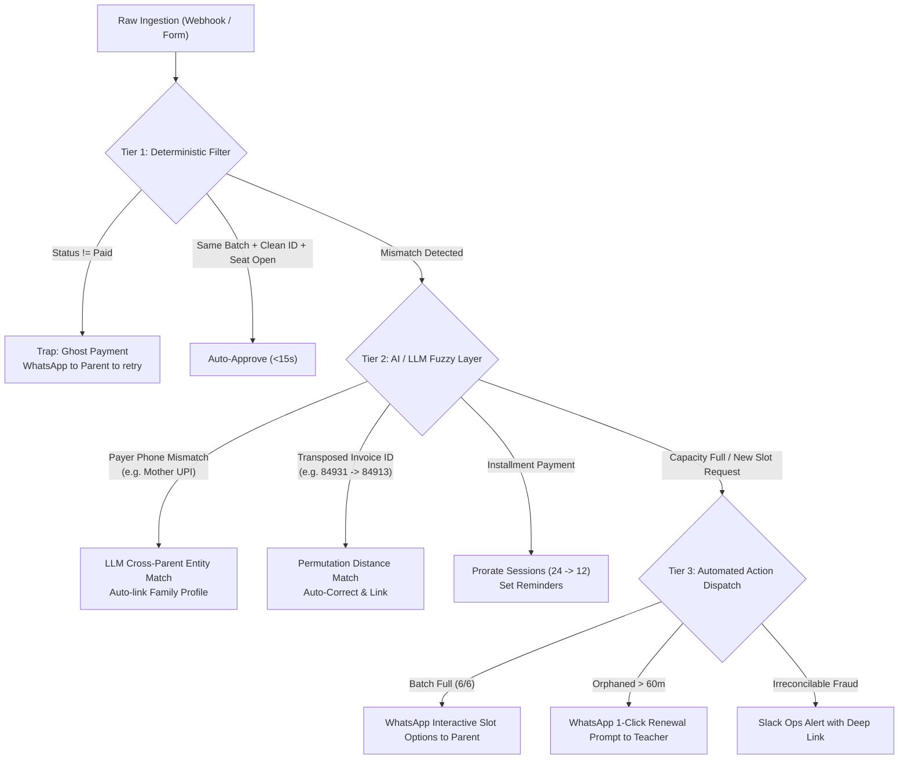

# ⚙️ Deliverable B: AI & No-Code Re-Engineered Workflow (The 'Zero-Touch' Ideal)

> **Bambinos.live • AI Program Manager (Operations) Assessment**  
> **Topic:** End-to-End Architectural Blueprint for Autonomous Renewal & Scheduling  
> **Prepared For:** Head of Operations  

---

## 1. Architectural Philosophy: The "Zero-Touch" Paradigm

The cardinal sin of the current process is treating educators as administrative data clerks. In our re-engineered architecture:

> **"If the student is continuing in the same batch with the same educator and has paid the required fee, no human should ever touch the record."**

```
+---------------------------------------------------------------------------------------------------------+
|                                    RE-ENGINEERED PIPELINE TOPOLOGY                                      |
+---------------------------------------------------------------------------------------------------------+

  [Payment Link Generated with Metadata]
  (student_id, batch_id, educator_id pre-embedded)
               │
               ▼
  [Razorpay / Stripe Webhook Fired]
               │
               ▼
  ┌────────────────────────────────────────────────────────────────────────┐
  │                   STAGE 1: DETERMINISTIC RULES ENGINE                  │
  │  1. Is payment_status == 'Paid'?                                       │
  │  2. Is net_amount >= required_tier_fee?                                │
  │  3. Does continue_same_batch == True?                                  │
  │  4. Is batch_active_count < max_batch_size?                            │
  └───────────────────────────────────┬────────────────────────────────────┘
                                      │
               ┌──────────────────────┴──────────────────────┐
               │                                             │
      [ALL PASS (Happy Path)]                   [FLAG TRIGGERED (Exception)]
               │                                             │
               ▼                                             ▼
  ┌────────────────────────┐              ┌─────────────────────────────────────┐
  │   STAGE 2: ZERO-TOUCH  │              │    STAGE 3: AI EXCEPTION ROUTER     │
  │      AUTO-BOOKING      │              │  • Fuzzy Identity Match (LLM)       │
  │  • Writes to class_    │              │  • Transposition Auto-Correction    │
  │    schedule_bookings   │              │  • Installment Session Proration    │
  │  • WhatsApp dispatch   │              │  • Capacity Alternative Generator   │
  │    to Parent & Teacher │              └──────────────────┬──────────────────┘
  │  • Duration: < 15 sec  │                                 │
  └────────────────────────┘                                 │
                                            ┌────────────────┴────────────────┐
                                            │                                 │
                                  [Autonomous Action]              [Human Ops Escalation]
                                  • WhatsApp Slot Picker           • Pre-computed Slack Alert
                                  • 1-Click Teacher Confirm        • 1-Click Approval Cockpit
```

---

## 2. Eliminating Manual Steps in the Happy-Path

### What Gets Eliminated:
1. **Elimination of `faculty_form_unapproved` for Clean Renewals:**
   * **Mechanism:** When a teacher initiates a renewal pitch in the CRM, the payment link carries signed metadata tokens:  
     `https://pay.bambinos.live/renew?sid=68101&bid=9201&eid=1102&sess=24`
   * When payment clears, the gateway payload contains these exact foreign keys. The teacher is **never asked to fill out a Google Form or web form**.
2. **Elimination of Manual Ops Invoice Verification:**
   * Gateway webhooks verify cryptographic signatures (HMAC SHA-256) directly from Razorpay/Stripe. Human Ops verification of transaction screenshots is rendered obsolete.
3. **Elimination of Manual Calendar Session Creation:**
   * An automated database trigger generates the next 24 class schedule records in `class_schedule_bookings` based on the batch schedule pattern (`Tue,Thu @ 17:00`).

---

## 3. Multi-Tier Smart Exception Handling Engine

When inputs deviate from the happy path, our 3-tier triage architecture ensures targeted, automated resolution:



### Deep-Dive: Specific Exception Triage Playbooks

#### Scenario 1: Cross-Parent Payer Identity Mismatch (e.g., Record 84904)
* **Problem:** Mother pays from `+91-9844XXXX77`; CRM has father's number `+91-9844XXXX04`.
* **AI Agent Resolution:**
  1. The LLM agent inspects the student record, parent surname, and active batches associated with educator `1102`.
  2. It identifies a high-confidence match (Confidence: 0.99) between `Ri***u Iy***r` and student `An***a Iy***r`.
  3. Action: Auto-approves the booking, adds the mother's phone number as a secondary contact in the family CRM profile, and issues the WhatsApp confirmation to both numbers.

#### Scenario 2: Batch Capacity Overflow (e.g., Record 84905)
* **Problem:** Educator renewed student into Batch `9205` which is already at maximum capacity (6/6 students).
* **AI Agent Resolution:**
  1. System halts auto-booking for Batch `9205` before database collision occurs.
  2. Queries active batch database for identical curriculum level (`Unbox Chess Level 2`) taught by the same or equivalent master educators with open seats.
  3. Dispatches an automated interactive WhatsApp message to Parent `Me***a Pa***l`:
     > *"Dear Me***a, your renewal for Re***h is confirmed! Coach Arvind's weekend 11 AM batch has reached its small-group limit of 6 students. We have reserved 2 priority options for you: [1: Wed & Fri 5 PM] or [2: Sat & Sun 2 PM]. Reply 1 or 2 to confirm."*
  4. Once parent replies via WhatsApp webhook, the system instantly completes the booking. Ops never has to make an awkward apologetic phone call.

#### Scenario 3: Orphaned Invoice Detection (e.g., Records 84906 & 84910)
* **Problem:** Invoice paid on Stripe/Razorpay, but no renewal confirmation exists after 60 minutes.
* **AI Agent Resolution:**
  1. The orphan scanner runs an automated cron check every 15 minutes.
  2. Any paid invoice with no booking after 60 minutes triggers an interactive WhatsApp message to the assigned educator:
     > *"Hi Ms. Rhea, parent of Zo***a Kh***n just renewed for 24 sessions. Tap here to confirm continuation in Batch 9206 with 1 click: [Confirm Continuation]"*
  3. If teacher taps Confirm $\to$ Auto-booked.
  4. If unanswered at 4 hours $\to$ If same-batch seat is open, system auto-books defensively and alerts Ops.

---

## 4. No-Code Tech Stack Implementation Specification

To ensure immediate deployment within 48–72 hours without extensive core engineering overhead:

| Component | Recommended Tool | Role & Justification |
| :--- | :--- | :--- |
| **Orchestration Engine** | **n8n (Self-Hosted) or Make.com** | Visual flow builder handling webhooks, branching logic, conditional retries, and API integrations. Native error handling and execution logging. |
| **AI Entity Resolution** | **LLM Agent (Gemini 1.5 Flash / GPT-4o-mini)** | Ultra-low latency (<500ms), low-cost JSON-mode agent for fuzzy entity matching, name matching, and typo correction. |
| **Messaging Channel** | **Interakt / Wati (WhatsApp Business API)** | Interactive WhatsApp templates with Quick-Reply buttons for parent slot selection and teacher 1-tap confirmation. |
| **Internal Ops Alerts** | **Slack Webhook API** | Real-time `#ops-renewals-escalations` alerts with embedded action buttons (`[Approve Override]`, `[View Diff]`). |
| **Operational Analytics** | **Metabase / Google Looker Studio** | Live read-replica dashboard displaying hourly pipeline metrics, stuck invoices, and SLA breaches. |
| **Database** | **Bambinos Production MySQL / PostgreSQL** | Canonical source of truth (`invoices`, `class_schedule_bookings`, `classbatches`). |

